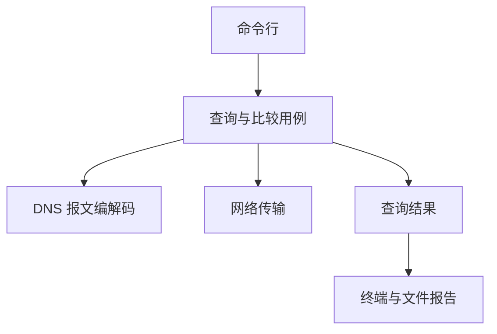

# 架构

本文说明模块职责、依赖方向和一次查询的数据流。产品目标见 [prd.md](prd.md)，首版范围见 [mvp.md](mvp.md)，实际完成情况见 [todo.md](todo.md)。当前已实现单服务器 UDP、TCP 与自动回退用例；完整命令、比较和报告仍为后续设计。

## 模块与依赖

| 模块 | 职责 | 边界 |
| --- | --- | --- |
| 命令行 | 解析选项、校验输入、调用用例、映射退出码 | 不实现报文解析或套接字收发 |
| 查询与比较用例 | 生成事务 ID、编排传输、验证响应、决定回退、汇总结果 | 不承担平台套接字细节 |
| 报文编解码 | 处理名称、查询报文、消息结构和记录数据 | 只处理内存数据，不访问网络、文件或终端 |
| 网络传输 | 管理套接字、连接、收发、来源端点和超时 | 不解释 DNS 状态码，不决定 UDP→TCP 回退 |
| 查询结果 | 保存服务器、尝试过程、有效响应及失败原因 | 不触发新的请求 |
| 报告 | 根据同一份结果生成终端输出和 JSON | 不重新查询、不改变查询结论 |

当前代码包含程序入口、`src/dns/` 的报文处理、`src/net/` 的端点、资源、预算与 UDP/TCP 收发，以及 `src/app/` 的响应匹配和单服务器查询。命令与报告接入时再创建对应目录，无需提前创建空目录或通用框架。

## 单服务器流程

1. 命令行依据 [cli.md](cli.md) 和 [validation.md](validation.md) 验证全部输入，失败时不发起请求。
2. 应用层生成事务 ID，构造一个问题，并记录该服务器查询的起始时间和绝对截止时间。
3. 编码器生成查询字节；网络层按所选方式发送并接收数据。
4. 对 UDP 检查来源 IP 和端口；解析消息结构，再验证 QR、事务 ID、OPCODE 以及唯一的 Question。
5. 若模式为 `auto` 且完整、匹配的 UDP 响应设置了 TC，使用剩余时间通过 TCP 查询同一问题。
6. 形成独立查询结果，交给报告层输出。

结构可解析不代表响应属于本次请求。来源、事务 ID、标志及问题匹配均通过后，才能接受为有效响应；名称匹配仅折叠 ASCII 大小写。忽略不匹配数据不能延长截止时间。

### 已实现的 UDP 用例

`src/app/udp_query.hpp` 的 `query_udp(question, server, budget, transaction_id)` 返回 `std::expected<UdpQueryResult, UdpQueryError>`。预算默认使用已确认的查询默认值；事务 ID 可由调用方指定，也可由用例生成。调用前应完成用户输入校验，用例仍独立检查预算范围、目标端口和问题编码，非法参数不能发包。

每次调用只创建一次截止时间、发送一次查询，不重传。收到数据后先比较来源端点，来源不符时直接忽略；来源相同才解析完整消息并匹配问题。正确响应到达后仍检查截止时间，成功结果保留服务器、问题、事务 ID、完整响应、微秒耗时和忽略的数据报数量。

`src/app/response_validator.hpp` 的 `validate_response(response, question, transaction_id)` 只处理已经解析的消息，按下列顺序返回首个不匹配项：

| 不匹配项 | 检查 |
| --- | --- |
| `NotResponse` | QR 必须为 1 |
| `TransactionId` | 事务 ID 必须相同 |
| `Opcode` | OPCODE 必须为 0 |
| `QuestionCount` | 必须恰好有一个问题 |
| `QuestionName` | 名称按标签边界与 ASCII 大小写无关规则比较 |
| `QuestionType` | 类型必须相同 |
| `QuestionClass` | class 必须相同 |

有效的非零 RCODE、空 Answer、TC 及其他响应标志不会单独导致拒绝；显式 UDP 用例保留 TC，但不触发 TCP。应用层不把来源校验放入纯报文解析器。

错误保留分类 `code`、对应详情 `detail` 和 `ignored_datagrams`：

| 查询错误 | 行为 |
| --- | --- |
| `InvalidTimeout`、`InvalidEndpoint`、`Encode` | 预算、目标端口或问题编码不合法，发包前失败 |
| `IdGeneration` | 自动生成事务 ID 失败，发包前失败 |
| `Network` | 网络调用失败，保留操作阶段、系统码与网络错误分类 |
| `Timeout` | 预算耗尽且没有收到正确来源的无效响应；没有响应或只有错误来源均属于此类 |
| `InvalidResponse` | 预算耗尽前收到过正确来源的畸形或不匹配响应，保留最近一次解析错误或不匹配原因 |

畸形或不匹配的响应不立即终止等待；后续有效响应仍可成功，但等待不能续期。`ignored_datagrams` 统计来源错误与被拒绝的数据报总数。详情使用组合类型保存原始错误，不在核心层拼接用户提示。

### 已实现的统一查询用例

`src/app/query.hpp` 的 `query_server(question, server, mode, budget, transaction_id)` 返回 `std::expected<QueryResult, QueryError>`。`TransportMode` 提供 `Auto`、`Udp`、`Tcp`，默认 `Auto`；选项语义以 [cli.md](cli.md#传输与超时) 为准。原 `query_udp` 接口保留，通过统一用例执行显式 UDP 查询。

每次查询只生成一份事务 ID、报文和截止时间。TCP 直连目标后只发送一次带长度前缀的查询；自动模式先执行 UDP，仅在来源正确、报文完整且响应匹配的 TC 消息之后，向同一端点发送同一份 TCP 查询。最多发生一次回退，TCP 响应本身带 TC 时保留标志，不再次发起查询。

| 数据 | 内容 |
| --- | --- |
| `QueryResult` | 服务器、问题、事务 ID、最终传输、完整响应、总耗时、忽略消息数和全部尝试 |
| `QueryError` | 错误分类与详情、总耗时、忽略消息数和已经发生的尝试 |
| `QueryAttempt` | 本次传输、本次耗时、有效响应或失败原因，以及本次忽略消息数 |

`QueryTransport` 只表示实际使用的 `Udp` 或 `Tcp`。每次尝试通过 `outcome` 保存响应或 `QueryFailure`，无论整体成功还是失败都能读取历史。回退失败时，第一次尝试仍保留有效 UDP TC 响应，第二次保存 TCP 失败；整体返回失败，不能把之前的截断响应当作最终成功结果。

总耗时包含报文准备，各次尝试耗时从进入网络阶段开始计算。进入 TCP 尝试时如果预算已到期，记录该次超时但不连接；尝试记录本身不表示查询已经发出。

TCP 每次读取一个完整帧，再复用 DNS 解析与响应匹配。合法长度帧中的畸形消息或不匹配响应可被忽略，后续帧仍有机会成功；耗尽预算时按是否收到过无效响应区分 `Timeout` 与 `InvalidResponse`。长度前缀不合法时立即返回 `InvalidResponse`，详情保留网络层的 `InvalidMessageLength`；连接失败、提前关闭与其他网络错误返回 `Network`，不会被之前的无效响应覆盖。

`QueryErrorCode` 沿用 UDP 的错误含义，并增加发包前拒绝非法模式的 `InvalidMode`。非法预算、端口或问题同样在网络请求前失败；错误不改变 DNS RCODE 的含义。

## 时间与传输

每台服务器整个查询共用一个基于 `std::chrono::steady_clock` 的截止时间。UDP 收发、TCP 连接和收发、截断回退均使用剩余预算；部分收发和收到无关数据不能重置计时。具体选项范围由 [cli.md](cli.md) 维护。

首版采用同步 I/O 和薄的平台适配层。Windows 正确管理 Winsock 生命周期，Linux 正确管理文件描述符；套接字通过 RAII 释放。所有可能阻塞的操作受截止时间控制。

已实现的套接字默认非阻塞，同步查询通过可读、可写等待配合剩余预算完成收发。TCP 连接单独验证连接结果，不能只把可写事件当成成功。端点模型、资源所有权、截止时间与收发接口见 [network.md](network.md)。

TCP 消息带两字节长度前缀。实现必须完成部分发送、前缀读取和正文读取，并校验声明长度。UDP 超时直接记录超时，不能触发自动 TCP 查询。

## 比较流程

每个不同端点执行一次查询，各自拥有独立预算、尝试记录和结果。一台失败不能取消其他端点的查询。

首版允许顺序执行；后续可在保持上述语义的前提下并发。顺序执行时，整个比较命令可以超过单台服务器的时间预算。结果展示回答、状态和耗时差异，不把一次比较变成服务商排名。

## 结果与错误

查询结果至少保存：服务器端点、问题、实际传输、各次尝试、有效响应耗时、传输状态、DNS 状态码、标志、记录及错误。JSON 的交付字段见 [mvp.md](mvp.md#响应与输出交付)。

| 信息 | 含义 |
| --- | --- |
| 传输状态 | 是否成功获得并验证响应；可区分超时、连接拒绝、I/O 失败和无效响应 |
| DNS 状态码 | 服务器返回的协议结果；没有有效响应时为空 |
| 耗时 | 有效响应的查询耗时；没有有效响应时为空 |
| 尝试记录 | 保留 UDP 截断与后续 TCP 的过程，不用最后一次结果覆盖全部历史 |

`NXDOMAIN`、`SERVFAIL`、`REFUSED` 均可能出现在传输成功的结果中。空 Answer 不等于域名不存在；不同答案或 TTL 不同也不直接等于错误。

核心函数通过 `std::expected` 返回可恢复错误；解析错误使用稳定枚举和报文偏移，不在每个错误对象中生成字符串。网络错误独立保存阶段与系统错误信息，不能用 DNS 状态码代替。中文说明在命令行或报告边界生成，退出码由 [cli.md](cli.md#输出与退出码) 统一定义。

## 构建与依赖

- 使用 C++23，要求 `std::expected` 和 `std::span`；关闭编译器语言扩展。
- CMake 构建 `dnslab_core`、`dnslab`、`dnslab_tests` 和 `dnslab_integration_tests`；CTest 按 `smoke`、`unit`、`integration` 标签执行。
- Linux 持续集成只编译一次，产物交给 Ubuntu、Debian、Arch 分别运行；`tests/runtime` 只注册已有产物的测试，不查找编译器或重新编译。环境和执行入口见[构建说明](build.md#持续集成)。
- 已使用 CLI11 和 Catch2；JSON 报告开始实现时才引入相应依赖。
- vcpkg 固定实际验证的基线，具体步骤见 [build.md](build.md)。
- 自行实现 DNS 报文处理，不引入替代核心解析器的 DNS 客户端库。
- 首版不建立协程、事件循环或面向未来传输的插件系统。

## 测试边界

纯编解码测试直接使用内存字节，不依赖公网。网络集成测试使用本地模拟服务器，覆盖成功、DNS 错误、超时、错误来源、错误问题、截断回退及分段 TCP 数据。

同时验证报文边界、循环指针、计数不符和错误长度；不根据不可信计数提前分配大量内存。命令行测试验证非法输入在收发前被拒绝，报告测试验证字段、退出码和覆盖保护。各阶段验收与平台状态只记录在 [todo.md](todo.md)。
