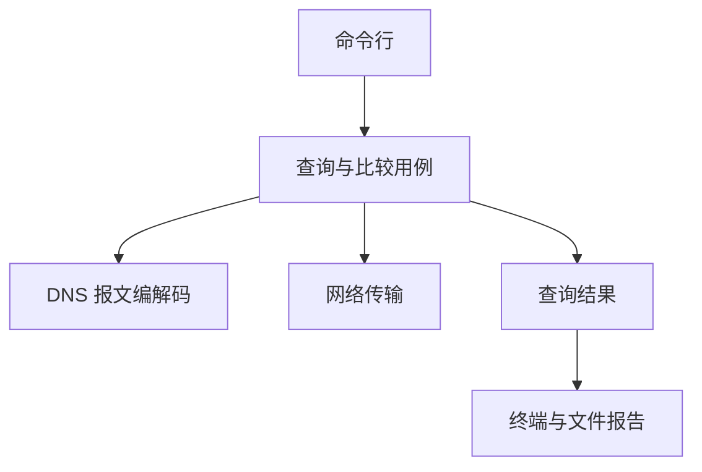

# 架构

本文说明模块职责、依赖方向和一次查询的数据流。产品目标见 [prd.md](prd.md)，首版范围见 [mvp.md](mvp.md)，实际完成情况见 [todo.md](todo.md)。下述查询、传输和报告流程是待实现设计。

## 模块与依赖

| 模块 | 职责 | 边界 |
| --- | --- | --- |
| 命令行 | 解析选项、校验输入、调用用例、映射退出码 | 不实现报文解析或套接字收发 |
| 查询与比较用例 | 生成事务 ID、编排传输、验证响应、决定回退、汇总结果 | 不承担平台套接字细节 |
| 报文编解码 | 处理名称、查询报文、消息结构和记录数据 | 只处理内存数据，不访问网络、文件或终端 |
| 网络传输 | 管理套接字、连接、收发、来源端点和超时 | 不解释 DNS 状态码，不决定 UDP→TCP 回退 |
| 查询结果 | 保存服务器、尝试过程、有效响应及失败原因 | 不触发新的请求 |
| 报告 | 根据同一份结果生成终端输出和 JSON | 不重新查询、不改变查询结论 |

当前代码包含程序入口、字节工具和名称处理。后续职责按需要落在 `src/cli/`、`src/app/`、`src/dns/`、`src/net/` 和 `src/report/`，无需提前创建空目录或通用框架。

## 单服务器流程

1. 命令行依据 [cli.md](cli.md) 和 [validation.md](validation.md) 验证全部输入，失败时不发起请求。
2. 应用层生成事务 ID，构造一个问题，并记录该服务器查询的起始时间和绝对截止时间。
3. 编码器生成查询字节；网络层按所选方式发送并接收数据。
4. 对 UDP 检查来源 IP 和端口；解析消息结构，再验证 QR、事务 ID、OPCODE 以及唯一的 Question。
5. 若模式为 `auto` 且完整、匹配的 UDP 响应设置了 TC，使用剩余时间通过 TCP 查询同一问题。
6. 形成独立查询结果，交给报告层输出。

结构可解析不代表响应属于本次请求。来源、事务 ID、标志及问题匹配均通过后，才能接受为有效响应；名称匹配仅折叠 ASCII 大小写。忽略不匹配数据不能延长截止时间。

## 时间与传输

每台服务器整个查询共用一个基于 `std::chrono::steady_clock` 的截止时间。UDP 收发、TCP 连接和收发、截断回退均使用剩余预算；部分收发和收到无关数据不能重置计时。具体选项范围由 [cli.md](cli.md) 维护。

首版采用同步 I/O 和薄的平台适配层。Windows 正确管理 Winsock 生命周期，Linux 正确管理文件描述符；套接字通过 RAII 释放。所有可能阻塞的操作受截止时间控制。

TCP 消息带两字节长度前缀。实现必须完成部分发送、前缀读取和正文读取，并校验声明长度。UDP 超时直接记录超时，不能触发自动 TCP 查询。

## 比较流程

每个不同端点执行一次查询，各自拥有独立预算、尝试记录和结果。一台失败不能取消其他端点的查询。

首版允许顺序执行；后续可在保持上述语义的前提下并发。顺序执行时，整个比较命令可以超过单台服务器的时间预算。结果展示回答、状态和耗时差异，不把一次比较变成服务商排名。

## 结果与错误

查询结果至少保存：服务器端点、问题、实际传输、各次尝试、有效响应耗时、传输状态、DNS 状态码、标志、记录及错误。JSON 的交付字段见 [mvp.md](mvp.md#响应与输出交付)。

| 信息 | 含义 |
| --- | --- |
| 传输状态 | 是否成功获得并验证响应；可区分超时、连接拒绝、I/O 失败和无效响应 |
| DNS 状态码 | 服务器返回的协议结果；没有有效响应时为空 |
| 耗时 | 有效响应的查询耗时；没有有效响应时为空 |
| 尝试记录 | 保留 UDP 截断与后续 TCP 的过程，不用最后一次结果覆盖全部历史 |

`NXDOMAIN`、`SERVFAIL`、`REFUSED` 均可能出现在传输成功的结果中。空 Answer 不等于域名不存在；不同答案或 TTL 不同也不直接等于错误。

核心函数通过 `std::expected` 返回可恢复错误；解析错误使用稳定枚举和报文偏移，不在每个错误对象中生成字符串。网络错误独立保存阶段与系统错误信息，不能用 DNS 状态码代替。中文说明在命令行或报告边界生成，退出码由 [cli.md](cli.md#输出与退出码) 统一定义。

## 构建与依赖

- 使用 C++23，要求 `std::expected` 和 `std::span`；关闭编译器语言扩展。
- CMake 构建 `dnslab_core`、`dnslab` 和 `dnslab_tests`；测试由 CTest 执行。
- 已使用 CLI11 和 Catch2；JSON 报告开始实现时才引入相应依赖。
- vcpkg 固定实际验证的基线，具体步骤见 [build.md](build.md)。
- 自行实现 DNS 报文处理，不引入替代核心解析器的 DNS 客户端库。
- 首版不建立协程、事件循环或面向未来传输的插件系统。

## 测试边界

纯编解码测试直接使用内存字节，不依赖公网。网络集成测试使用本地模拟服务器，覆盖成功、DNS 错误、超时、错误来源、错误问题、截断回退及分段 TCP 数据。

同时验证报文边界、循环指针、计数不符和错误长度；不根据不可信计数提前分配大量内存。命令行测试验证非法输入在收发前被拒绝，报告测试验证字段、退出码和覆盖保护。各阶段验收与平台状态只记录在 [todo.md](todo.md)。
