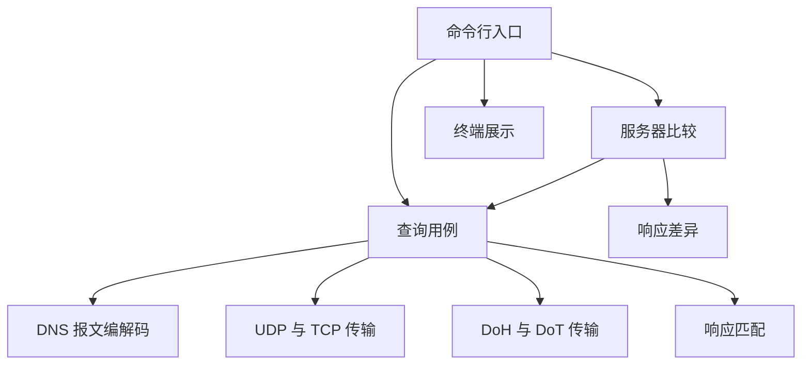

# 架构

本文说明当前查询与比较的模块职责、传输编排和结果模型。命令与输入规则分别见 [cli.md](cli.md)、[validation.md](validation.md)。JSON 报告尚未实现，其需求由 [prd.md](prd.md) 和 [mvp.md](mvp.md) 维护。

## 模块与依赖

| 位置 | 职责 | 边界 |
| --- | --- | --- |
| `src/main.cpp` | 解析选项、校验输入、调用查询、映射退出码 | 不实现报文解析或网络收发 |
| `src/cli/` | 将查询结果和错误转换为中文终端输出 | 不重新查询、不改变结论 |
| `src/app/` | 准备事务、编排传输、匹配响应、决定回退、汇总尝试及比较结果 | 不承担平台套接字或 TLS 细节 |
| `src/dns/` | 处理名称、查询编码、消息解析和记录数据 | 只操作内存，不访问网络、文件或终端 |
| `src/net/` | 处理端点、资源所有权、截止时间和消息收发 | 不解释 DNS RCODE，不决定 UDP→TCP 回退 |

普通传输使用自有的非阻塞套接字适配；加密传输使用 libcurl 管理 HTTPS/TLS 连接。二者共享 DNS 编解码、响应匹配和截止时间模型。具体网络接口见 [network.md](network.md)，报文契约见 [wire-codec.md](wire-codec.md)。

## 查询流程

1. 命令行检查选项组合、名称、目标和预算；显式 CA 文件还要通过基本预检。应用层独立复核其公开接口的参数。
2. 应用层建立绝对截止时间，编码问题并确定事务 ID；普通查询及 DoT 默认生成 ID，DoH 默认使用零，调用方也可显式提供。
3. 网络层发送查询并读取数据。UDP 先核对来源地址族、IP 和端口；其他传输使用已建立的目标连接。
4. 解析完整 DNS 消息并进行响应匹配；只有验证通过且预算未到期才接受为成功。
5. 普通 `auto` 模式按下述条件回退，其余模式直接形成结果；命令行展示响应或错误以及尝试过程。

每次查询只有一个基于 `steady_clock` 的截止时间。模式、预算、目标及 CA 基本预检在计时前完成，报文编码和事务 ID 准备计入总耗时。各次尝试从进入传输流程开始计时，因此尝试记录并不表示请求已经发出。部分收发、忽略无关消息和重新等待都不能续期。

### 普通查询

`query_server(question, server, mode, budget, transaction_id)` 位于 `src/app/query.hpp`，返回 `std::expected<QueryResult, QueryError>`。`server` 使用字面 IP 的 `Endpoint`；`TransportMode` 为 `Auto`、`Udp`、`Tcp`，默认 `Auto`。同一次查询复用事务 ID、编码报文和截止时间，每次传输只发送一次请求，不重传。

- `Udp`：忽略错误来源的数据报；正确来源的畸形或不匹配响应也可被忽略，继续等待预算内的有效响应。
- `Tcp`：读取一个完整长度帧后解析和匹配；合法长度帧中的无效响应可被忽略，继续读取下一帧。非法帧长度立即失败，连接失败、提前关闭与其他网络错误保留原始原因。
- `Auto`：先 UDP，仅在来源正确、结构完整且匹配的响应设置 TC 时，向同一端点通过 TCP 发送同一查询。最多回退一次；UDP 超时不回退，TCP 响应带 TC 也不再查询。

普通查询耗尽预算时，如果本次尝试没有收到可归属目标的无效响应，返回 `Timeout`；否则返回 `InvalidResponse`，保留最近一次解析错误或不匹配原因。错误来源只增加忽略计数，不改变这一区分。后续网络失败不会被此前的坏响应掩盖。

`src/app/udp_query.hpp` 保留 `query_udp` 兼容接口，内部调用显式 UDP 模式，再转换为 `UdpQueryResult` / `UdpQueryError`；其 `ignored_datagrams` 对应统一模型的 `ignored_messages`。它不触发 TCP 回退。

### 加密查询

`query_encrypted(question, server, budget, tls, transaction_id)` 位于 `src/app/encrypted_query.hpp`，返回 `std::expected<EncryptedQueryResult, QueryError>`。目标使用 `EncryptedEndpoint` 保存 `Doh` 或 `Dot` 及规范地址，`TlsOptions` 可提供 CA 文件。

网络层负责服务器名称解析、TLS 握手和消息边界；应用层复用查询编码、消息解析及响应匹配。一次加密查询只交换一个请求与响应，畸形或不匹配响应直接返回 `InvalidResponse`，不重试、不切换传输。证书、连接或收发失败也不能触发明文回退。

DoH 使用 HTTPS POST 正文；DoT 在 TLS 上使用两字节长度帧，不发送 HTTP 请求。TLS 信任、HTTP 状态和媒体类型检查属于 [网络层](network.md#doh-与-dot)，不是 DNS 解析器职责。

## 服务器比较

`src/app/compare.hpp` 的 `compare_servers(question, servers, mode, budget)` 接受普通端点列表，返回 `std::expected<CompareResult, CompareError>`。先完整检查服务器数量、重复端点、端口、模式、预算和问题，再开始查询；全局参数错误不产生网络请求，并保留对应输入位置。

当前按输入顺序串行调用 `query_server`，每台独立创建截止时间，不共享整个列表的预算。单台的查询错误作为结果保留并继续下一台；自动回退仍由单服务器用例负责。`CompareResult` 保存问题、模式、总耗时与有序条目，每项包含服务器及完整的 `QueryResult` 或 `QueryError`，不将失败转换成空响应。

`compare_responses` 是纯内存接口，分别比较 RCODE、其他标志、三个记录区和 TTL。记录按名称、类型、类别与数据匹配，忽略顺序和名称的 ASCII 大小写，保留重复次数及不透明数据。TTL 在相同记录之间匹配，先抵消相同 TTL 的实例，再比较两侧剩余实例；单纯增删记录不算 TTL 变化。事务 ID 与耗时不参与响应一致性。

终端选择首个成功响应作为比较参照；遇到失败项只展示原因。成功响应不足两个时不形成一致性结论，答案或 TTL 差异也不决定查询是否成功。

## 响应匹配

`src/app/response_validator.hpp` 的 `validate_response(response, question, transaction_id)` 只接收已经解析的消息，按以下顺序返回首个不匹配项：

| 不匹配项 | 检查 |
| --- | --- |
| `NotResponse` | QR 必须为 1 |
| `TransactionId` | 事务 ID 必须相同 |
| `Opcode` | OPCODE 必须为 0 |
| `QuestionCount` | 必须恰好有一个问题 |
| `QuestionName` | 按标签边界比较，仅忽略 ASCII 字母大小写 |
| `QuestionType` | 原始 16 位类型必须相同 |
| `QuestionClass` | 原始 16 位类别必须相同 |

来源检查在传输用例中完成。非零 RCODE、空 Answer、TC 和其他响应标志不会单独导致匹配失败；资源记录内容不参与请求关联判断。

## 结果与错误

| 类型 | 内容 |
| --- | --- |
| `QueryResult` | IP 服务器、问题、事务 ID、最终传输、完整响应、总耗时、忽略消息数和全部尝试 |
| `EncryptedQueryResult` | 与普通结果相同的查询信息，服务器改为加密端点 |
| `QueryError` | 错误分类和详情、总耗时、忽略消息数和已发生的尝试 |
| `QueryAttempt` | 本次实际传输、耗时、响应或 `QueryFailure`，以及本次忽略消息数 |

`QueryTransport` 表示实际使用的 `Udp`、`Tcp`、`Doh`、`Dot`。回退失败时，首次尝试仍保存有效 UDP TC 响应，第二次保存 TCP 失败；整体结果由最后一次尝试决定，不能把截断响应当作最终成功。

| `QueryErrorCode` | 含义 |
| --- | --- |
| `InvalidMode`、`InvalidTimeout`、`InvalidEndpoint` | 传输枚举、预算或目标无效，在请求前返回 |
| `Encode`、`IdGeneration` | 问题编码或事务 ID 生成失败，在请求前返回 |
| `Timeout` | 查询预算耗尽；普通查询与已收到无效响应的区分见上文 |
| `InvalidResponse` | 响应结构、请求匹配、消息长度或 DoH 状态与媒体类型不合要求 |
| `Network` | 网络或 TLS 后端失败，详情保留具体原因 |

`QueryErrorDetail` 通过组合类型保留编码、解析、网络、响应匹配或加密错误，不在核心层生成提示字符串。显式 CA 预检失败使用 `Network` 与 `EncryptedErrorCode::InvalidTlsOptions` 详情，命令行将其识别为参数错误。

成功与失败都可记录耗时；计时前的参数预检失败时默认耗时为零且没有尝试。DNS RCODE 只来自已验证的响应，不能替代网络错误。`NXDOMAIN`、`SERVFAIL`、`REFUSED` 可以是传输成功的结果；空 Answer、不同答案或 TTL 差异也不直接等于传输失败。

## 展示与验证边界

终端层通过 `std::print` / `std::println` 展示目标、问题、完整响应、各记录区和尝试过程，错误说明在此边界生成；退出码由 [cli.md](cli.md#输出与退出码) 定义。代码风格见 [style.md](style.md)，工具链与依赖见 [build.md](build.md)。

编解码和响应匹配测试使用内存数据；网络及命令行测试使用本地模拟 UDP、TCP、HTTPS 和 TLS 服务器，不依赖公共 DNS。测试覆盖来源与问题匹配、截断回退、部分收发、证书失败和共享预算；实际平台验证与待办统一记录在 [todo.md](todo.md)。
